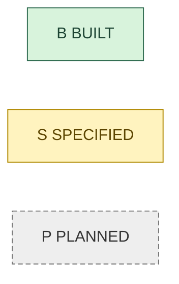
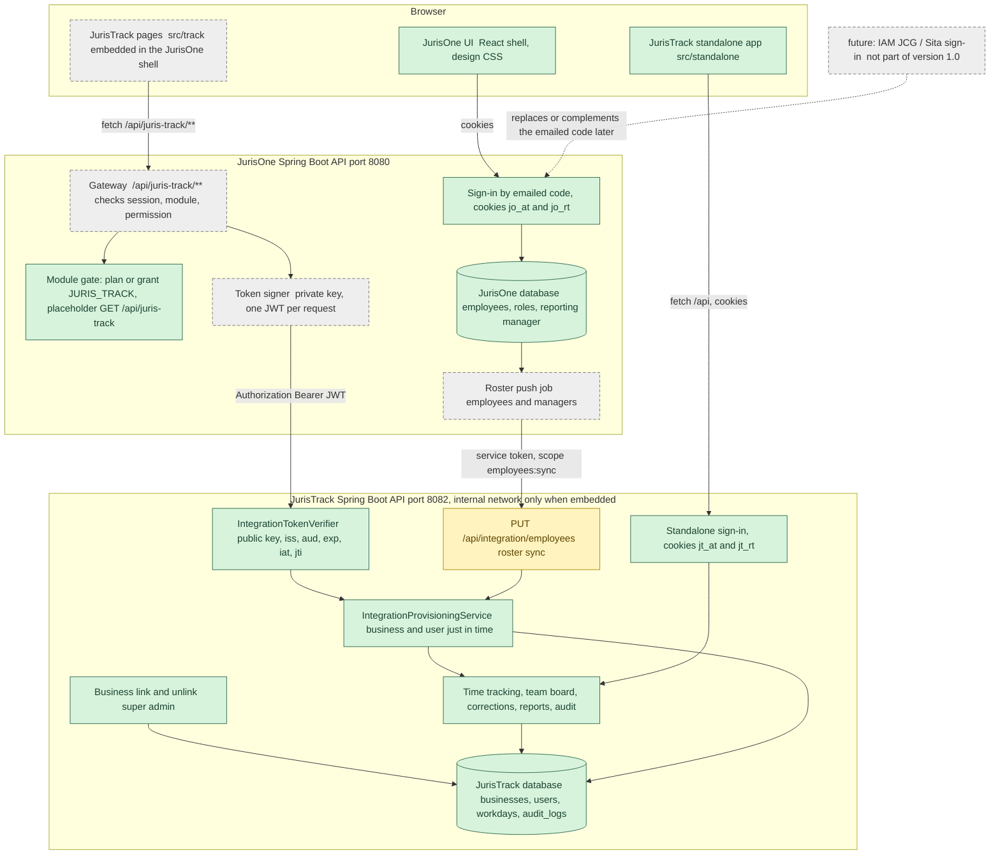
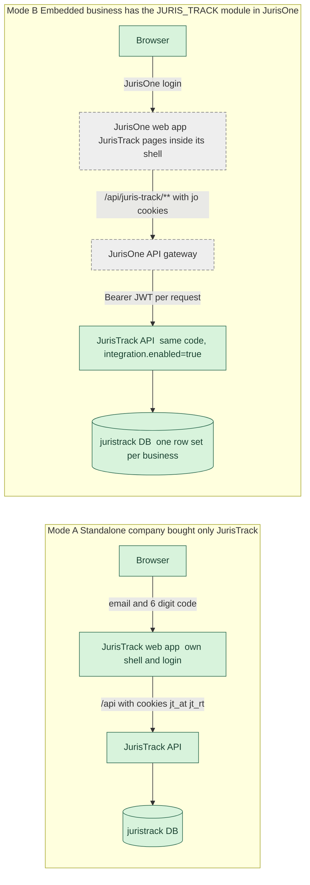
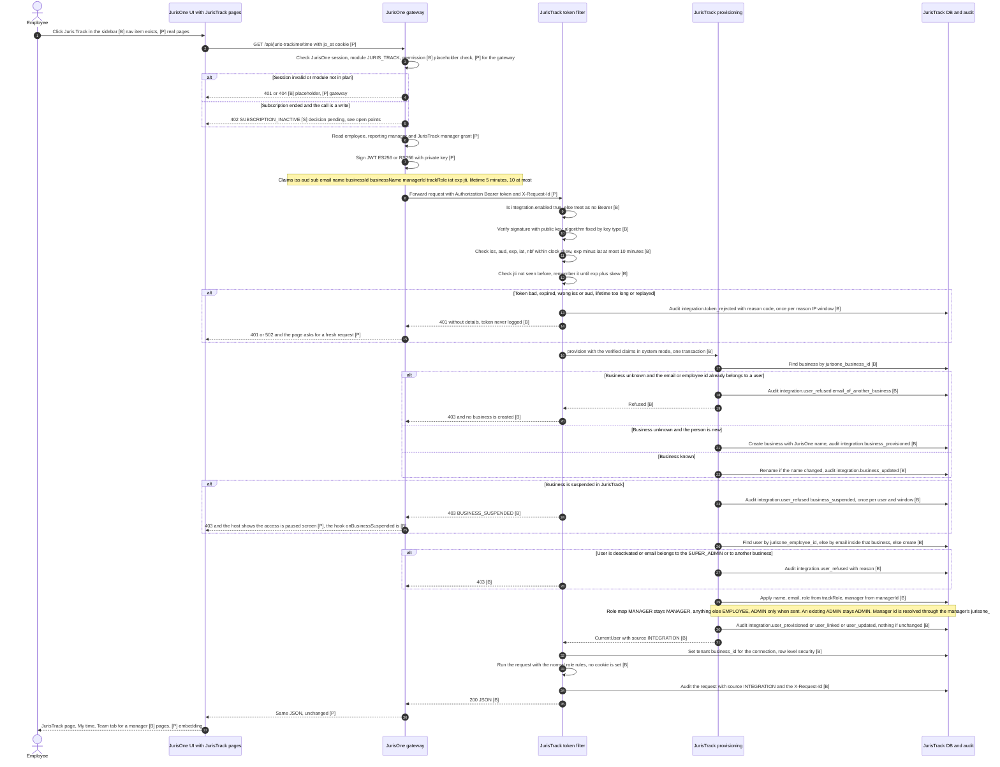
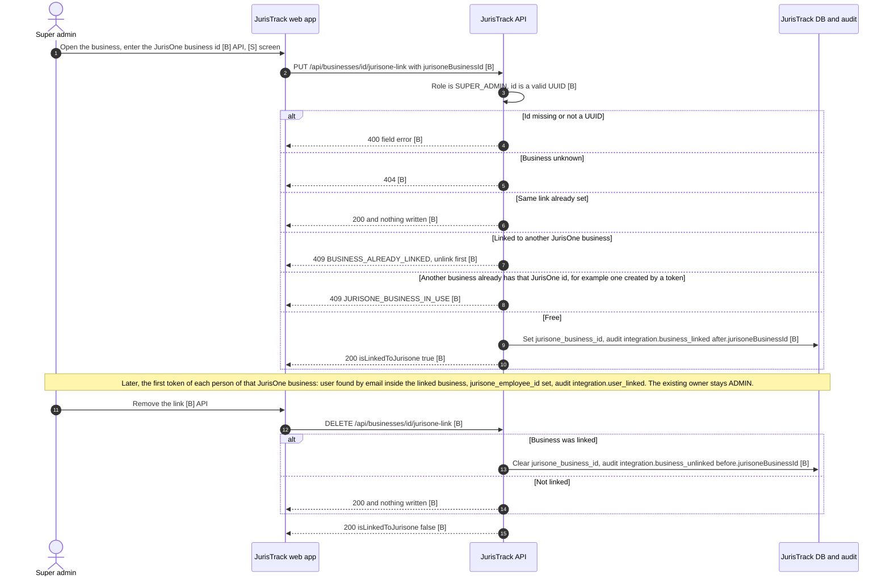
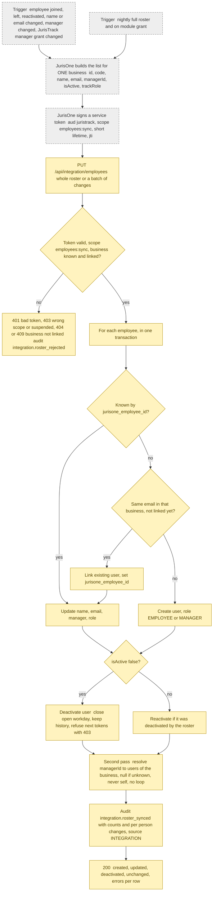

# Connection flow: JurisTrack and JurisOne

| Version | Date | What changed | Requested by |
|---|---|---|---|
| 1.0 | 2026-10-23 | Initial version | Owner |

Master copy: `juris-track-backend/references/`. The `Juris-one` backend keeps an identical copy with the same version (see "Documents" in both `INSTRUCTIONS.md`).
Related documents: [FRD-JurisOne.md](FRD-JurisOne.md), [FLOW-JurisOne.md](FLOW-JurisOne.md), [FRD-JurisTrack.md](FRD-JurisTrack.md), [FLOW-JurisTrack.md](FLOW-JurisTrack.md). Design source: `INTEGRATION.md`, `MIGRATION_PLAN.md`, `API.md` (this folder).

**Scope of version 1.0:** JurisOne signs users in with its own emailed code; JurisTrack trusts a token signed by JurisOne. **IAM JCG / Sita is not part of this version**; a later version will add it (placeholder in the overview).

## 0. How to read this document (status legend)

The JurisTrack side of the connection is built or specified. **The JurisOne side (gateway, token signing, roster push, embedding in the JurisOne UI) is not built yet.** Every step in every diagram carries one of three states, shown as a tag in its label and, in flowcharts, as a colour.

| Tag | State | Meaning | Colour in flowcharts |
|---|---|---|---|
| `[B]` | BUILT | Code exists and is tested in the repo today | green |
| `[S]` | SPECIFIED | Designed and written down (`INTEGRATION.md` / `API.md`), no code yet | amber |
| `[P]` | PLANNED | Intended, only decided in outline, no detailed design | grey, dashed |

Rule of thumb: everything inside JurisTrack that verifies a token or links a business is `[B]`; everything that has to be done inside JurisOne to produce that token is `[P]`; the roster endpoint is `[S]` on both sides.

## 1. Big picture

Two products, one browser origin per product mode. In embedded mode the browser only talks to JurisOne; the JurisOne backend is the gateway and is the only caller of the JurisTrack API.

### What is shared and what is separate

| Topic | Shared or separate | Detail | State |
|---|---|---|---|
| Design | Shared | Both UIs use the JurisOne People prototype CSS verbatim plus a small "additions" block each, so embedded pages look native | `[B]` |
| Translation | Shared convention | English text is the key (`t("...")`); each product keeps its own Hindi file (JurisTrack exports `trackHindiMessages` and `trackHindiApiMessages` for a host to merge) | `[B]` Track side, `[P]` merge in JurisOne |
| Roles | Mapped, not shared | JurisOne roles and permissions stay in JurisOne; JurisTrack has a fixed set (`ADMIN`, `MANAGER`, `EMPLOYEE`, `SUPER_ADMIN`). Mapping in section 6 | `[B]` Track side, `[P]` JurisOne side |
| Business identity | Linked | `businesses.jurisone_business_id` in JurisTrack equals the JurisOne business id (unique) | `[B]` |
| Employee identity | Linked | `users.jurisone_employee_id` equals the JurisOne employee id (unique) | `[B]` |
| Reporting line | Copied from JurisOne | JurisOne `reporting_manager_id` becomes JurisTrack `manager_id` (token claim `managerId`, roster) | `[B]` token, `[S]` roster |
| Database | Separate | JurisTrack has its own database `juristrack`; there is no database import and no shared table | `[B]` |
| Sessions and cookies | Separate | JurisOne `jo_at` / `jo_rt`; JurisTrack `jt_at` / `jt_rt` (standalone only). JurisTrack never sees JurisOne cookies | `[B]` |
| Audit log | Separate | Each product writes its own append-only audit; JurisTrack tags gateway calls with source `INTEGRATION` and the `X-Request-Id` | `[B]` |
| Code base | One per product | Same JurisTrack code runs standalone and embedded; the switch is `juristrack.integration.enabled` | `[B]` |

## 2. Deployment modes

| | Standalone `[B]` | Embedded |
|---|---|---|
| Who signs in | Employees of a company that bought only JurisTrack | Employees of a JurisOne business with the module |
| Login screen | JurisTrack's emailed code | JurisOne's (unchanged) |
| Session | `jt_at` (about 5 minutes, renewed silently) and `jt_rt` (rotating) | JurisOne's; JurisTrack sets no cookie |
| API caller | The browser, through the web app's `/api` proxy | The JurisOne gateway only (`[P]`); the JurisTrack API port is internal (`[S]` network rule) |
| Frontend | `src/standalone` supplies the `TrackContext` with `apiBasePath=/api` `[B]` | JurisOne supplies a `TrackContext` with `apiBasePath=/api/juris-track` and empty headers `[P]`; the seam itself is `[B]` |
| Users and business | Created by the super admin and the owner | Created just in time from the token `[B]` or pushed by the roster `[S]` |
| Endpoints and rules | Identical | Identical (one `CurrentUser`, built from the cookie or from the token) |

Both modes can run at the same time for different businesses of the same JurisTrack service. A standalone business becomes embedded only by an explicit link (section 4).

## 3. An employee opens JurisTrack from JurisOne

Precondition: the business has the `JURIS_TRACK` module (plan or grant) and the JurisOne public key is configured in JurisTrack. Every API call from the JurisTrack pages repeats the flow from the gateway step onward: the token is single-use, so there is one token per request.

Audit entries written in JurisTrack by this flow (all `[B]`): `integration.token_rejected`, `integration.user_refused`, `integration.business_provisioned`, `integration.business_updated`, `integration.user_provisioned`, `integration.user_linked`, `integration.user_updated`, and every normal entry of the request itself with source `INTEGRATION`. An unchanged user and a clean token write no entry of their own.

Cookies and session: the browser holds only JurisOne's `jo_at` / `jo_rt`. JurisTrack answers with no `Set-Cookie` and skips the Origin check for Bearer requests; the cross-site defence is the gateway's job. A 401 from the gateway triggers JurisOne's one silent refresh (`TrackContext.onUnauthorized`, `[B]` seam, `[P]` wiring).

## 4. Linking a standalone business to JurisOne

A company that started standalone and later buys JurisOne is linked by the platform super admin, never by a token. A token alone never adopts an existing business.

**Why email auto-adoption is refused.** If a token with an email that already exists could adopt that user's business, any standalone owner could add an employee with a JurisOne colleague's email. The first token of that colleague's company would then hand the whole company to the owner who planted the address. Therefore a token for an unknown JurisOne business that carries a known email or employee id is answered 403 `email_of_another_business` and no business is created. The super admin checks the real-world ownership and links explicitly.

## 5. Roster sync: employees from JurisOne to JurisTrack

**State: SPECIFIED on the JurisTrack side (endpoint not built, see `MIGRATION_PLAN.md` step 5b), PLANNED on the JurisOne side (no job, no event hook).** The token path in section 3 provisions only people who actually open JurisTrack. A manager must also see reports who never opened it, so JurisOne pushes the roster.

What happens on each event (all `[S]` for JurisTrack, `[P]` for the JurisOne trigger):

| Event in JurisOne | Roster effect in JurisTrack |
|---|---|
| Employee joins | User created (role from `trackRole`, default `EMPLOYEE`) without signing in; appears on their manager's board as "not started" |
| Employee leaves or is deactivated | `isActive=false`: user deactivated, open workday closed, history kept, later tokens answer 403 |
| Employee reactivated | User reactivated at the next push |
| Manager changes | `manager_id` updated; workdays already recorded keep their manager snapshot; the new manager sees the person from now on |
| JurisTrack manager grant given or removed | `trackRole` changes `MANAGER` / `EMPLOYEE`; an existing `ADMIN` is not downgraded |
| Email or name changed | Updated on the linked user, matched by `jurisone_employee_id` |
| Push never arrives | The token path (section 3) still provisions and refreshes whoever signs in `[B]` |

Details of the roster response and the audit names `integration.roster_synced` and `integration.roster_rejected` are proposals of this document; `INTEGRATION.md` only fixes the request, the scope and the idempotence. Idempotent: the same list twice changes nothing and writes no further audit entry. The roster endpoint is the only endpoint a service token may call; the user token cannot call it.

## 6. Role and permission mapping

JurisOne has a rich role and permission model (for example `self`, `dir`, `roles.manage`, `business.manage`). JurisTrack has four fixed roles and no permission table. JurisOne decides, and sends the result as the claim `trackRole` on every token and in every roster row.

| JurisOne side | `trackRole` sent | JurisTrack role | What the person can do in JurisTrack | State |
|---|---|---|---|---|
| Any employee with the module available, whatever role (HR, Finance, ...) | none or `EMPLOYEE` | `EMPLOYEE` | Own time tracking, own history, profile | `[B]` Track, `[P]` JurisOne |
| Employee granted the "JurisTrack manager" role in JurisOne | `MANAGER` | `MANAGER` | Personal section plus Team tab: live board, history, reports and corrections for direct reports, optional indirect level; never their own time | `[B]` Track, `[P]` the grant itself does not exist in JurisOne yet |
| Business owner in JurisOne | `ADMIN` only if JurisOne decides to send it | `ADMIN` | Everything inside the business: people, settings, audit, corrections | `[B]` Track, decision open (open point 3) |
| Employee with reports but without the JurisTrack manager role | `EMPLOYEE` | `EMPLOYEE` | Sees nobody else, even with reports | `[B]` |
| JurisOne platform super admin | not sent | no mapping | Never signs in to JurisTrack through a token; a token with the email of the JurisTrack `SUPER_ADMIN` is refused 403 | `[B]` |
| JurisTrack `SUPER_ADMIN` | none | `SUPER_ADMIN` | Platform user of JurisTrack, no business: creates businesses, owners, links, suspends; standalone only | `[B]` |

Rules of the mapping (`[B]`):
- The token is authoritative on every call for name, email, role and manager. A downgrade in JurisOne takes effect on the next call.
- An existing `ADMIN` keeps the owner role unless the token itself says otherwise, so linking can never leave a business without an owner.
- A claim value other than `MANAGER` or `ADMIN` means `EMPLOYEE`.

**Reporting line.** The team is the reporting line, not a separate object. JurisOne's `reporting_manager_id` is sent as `managerId` (token) and in the roster. JurisTrack resolves it through the manager's `jurisone_employee_id` inside the same business. If the manager is not known yet it stays null until the manager appears (token or roster); a person is never their own manager. Scope of a manager: direct reports by default, one switch for the next level; the depth is a parameter.

## 7. Data ownership

| Datum | Source of truth | Copy in the other product | How it travels | State |
|---|---|---|---|---|
| Business existence, subscription and module `JURIS_TRACK` | JurisOne when embedded; JurisTrack when standalone | JurisTrack keeps the JurisOne business id | Token (`businessId`), explicit link | `[B]` Track, `[P]` JurisOne |
| Business name | JurisOne when linked | JurisTrack follows on each token | Token `businessName`, audit `integration.business_updated` | `[B]` |
| Business settings (time zone, stale workday hours, display time zones) | JurisTrack | none | Set by the owner in JurisTrack | `[B]` |
| Business suspension for non-payment | Each product separately | none | No signal either way yet | open point 6 |
| Employee identity (name, email, code, active) | JurisOne when embedded | JurisTrack user | Token, roster | `[B]` token, `[S]` roster |
| Reporting manager | JurisOne when embedded; JurisTrack owner when standalone | `manager_id` | Token `managerId`, roster | `[B]` token, `[S]` roster |
| JurisTrack manager grant | JurisOne | `users.role` | Token `trackRole`, roster | `[B]` Track, `[P]` JurisOne |
| Workdays, work and break sessions, live status, totals | JurisTrack only | none | Not sent to JurisOne in version 1.0 | `[B]` |
| Corrections of time (reason mandatory) | JurisTrack only | none | Made by manager or owner in JurisTrack | `[B]` |
| JurisOne attendance, leave, punches | JurisOne only | none | No exchange in version 1.0 | open point 7 |
| Audit of JurisTrack | JurisTrack only | none | Own append-only table | `[B]` |
| Audit of the gateway call | JurisOne audit for its own side | request id | `X-Request-Id` is stored in JurisTrack entries | `[B]` Track, `[P]` JurisOne |

**When the link is removed** (`DELETE .../jurisone-link`, `[B]`): the business becomes a standalone business again. Users, workdays and audit stay; each user's `jurisone_employee_id` stays recorded. Tokens of that JurisOne business no longer match a business: if the persons exist, the token is refused 403 `email_of_another_business`, otherwise a brand new, empty business would be created for an unknown person. The standalone sign-in by emailed code then works for those people, the owner assigns managers, and the roster no longer applies. Before unlinking, JurisOne should stop issuing tokens for that business (open point 4).

## 8. Failure and security cases

| Case | What happens | Status code and audit | State |
|---|---|---|---|
| Token replay (same `jti` twice) | Second use refused; the gateway must sign a fresh token for every request. The memory is per instance | 401, `integration.token_rejected` reason `replayed_token` | `[B]` |
| Replay guard with several JurisTrack instances | Each instance remembers separately; a shared store is needed before scaling out | open point 8 | `[S]` |
| Expired token, or issued in the future | Refused beyond the allowed skew | 401, reasons `expired`, `issued_in_the_future`, `not_valid_yet` | `[B]` |
| Lifetime longer than 10 minutes, no `iat`, no `exp`, no `jti` | Refused | 401, reasons `lifetime_too_long`, `missing_issue_time`, `missing_expiry`, `missing_claim: jti` | `[B]` |
| Clock skew between the servers | Tolerance `clock-skew-seconds` (default 30). Both servers should use NTP | 401 `expired` if beyond the tolerance | `[B]` |
| Wrong signature, unsigned token, `alg=none`, symmetric algorithm | Refused: the algorithm is fixed by the configured public key type (RS256 or ES256) | 401 `bad_signature`, `unexpected_algorithm`, `malformed_token` | `[B]` |
| Wrong `iss` or `aud` | Refused | 401 `wrong_issuer`, `wrong_audience` | `[B]` |
| Private key put in JurisTrack config | Application refuses to start | start-up error | `[B]` |
| Integration switched off | Bearer header is ignored; standalone sign-in still works | normal 401 | `[B]` |
| Key rotation | Only one public key can be configured; JWKS URL planned | none | `[S]` |
| Proxy trust | The gateway address must be in `juristrack.security.trusted-proxies`, or the forwarded `X-Forwarded-For` is not believed and audit IP and limits see only the gateway | none | `[B]` setting, `[P]` deployment |
| Rate limits | The built-in limits cover sign-in (emailed code per IP and per email, failed sign-ins) only. Bearer requests are not limited in JurisTrack; the gateway must limit per user and per business | 429 from the gateway | `[B]` sign-in, `[P]` gateway |
| API reachable from the internet in embedded mode | Anyone with a stolen token could call it within its lifetime; the API port must be internal only or behind mTLS | network rule | `[S]` |
| Origin check | Skipped for Bearer requests; the gateway carries the cross-site defence | none | `[B]` |
| Business suspended in JurisTrack | Token user refused; open workdays were closed at suspension | 403 `BUSINESS_SUSPENDED`, audit `integration.user_refused` once per user and window | `[B]` |
| Business suspended or subscription ended in JurisOne | JurisOne gate answers first (402, or read-only when ended); JurisTrack is not told, so data stays and open workdays stay open | 402 from JurisOne | `[P]`, open point 6 |
| Employee deactivated in JurisTrack | Token refused | 403, `integration.user_refused` reason `user_deactivated` | `[B]` |
| Employee deactivated or left in JurisOne | Gateway stops signing tokens at once; JurisTrack user deactivated by the next roster push (open workday closed) | 403 from the first push on | `[B]` token side, `[S]` roster |
| Email of a user of another business, or of the `SUPER_ADMIN` | Refused, no business created | 403, `email_of_another_business` | `[B]` |
| JurisOne business unknown and person new | Business and user created just in time | 200, `integration.business_provisioned` | `[B]` |
| Token missing a claim or with a bad UUID | Refused | 401, `missing_claim: name`, `invalid_claim: sub` | `[B]` |
| JurisTrack down or slow | Gateway answers 502 or 504; the page shows a retry; no JurisOne data is lost | 502 or 504 | `[P]` |
| Token or key problem inside the gateway (cannot sign) | Gateway answers 500 and alerts; nothing reaches JurisTrack | 500 | `[P]` |
| Tokens or keys in logs | Tokens are never logged; the reason code only | none | `[B]` |

## 9. What is left to build

In order (each step can be tested before the next). `[x]` = done, `[ ]` = open.

JurisTrack side
- [x] Token verifier: signature, issuer, audience, times, skew, lifetime, single-use `jti`
- [x] Just-in-time provisioning of business and user, role and manager from the token, audit entries
- [x] Business link and unlink by the super admin with the two 409 errors and audit
- [x] One `CurrentUser` (source `STANDALONE` or `INTEGRATION`), row level security from it
- [x] `TrackContext` seam in `src/track` (API base path, headers, user, language, navigation, suspended hook)
- [ ] `PUT /api/integration/employees` with a service token and scope `employees:sync`, with tests and audit (`integration.roster_synced`)
- [ ] Super admin screen to link and unlink a business (API exists)
- [ ] JWKS URL for key rotation; shared replay store if more than one instance
- [ ] Document the network rule and `trusted-proxies` for the embedded deployment

JurisOne side (nothing of this exists yet)
- [ ] Choose and generate the key pair; private key only in JurisOne; give JurisTrack the public key and the exact `iss` value
- [ ] "JurisTrack manager" grant in JurisOne roles and permissions; mapping function JurisOne role -> `trackRole`
- [ ] Gateway controller `/api/juris-track/**`: session, module gate, permission, per-call token, forward, error mapping, rate limit
- [ ] Token signer service (one JWT per request, 5 minutes, `jti`)
- [ ] Roster push: change hooks plus nightly job, service token
- [ ] JurisOne frontend embeds `src/track` (package or federation), supplies its `TrackContext`, merges the Hindi messages, replaces the "Coming soon" page
- [ ] Suspension and subscription handling toward JurisTrack
- [ ] Tests across both repos (end to end with both backends)
- [ ] Update this document and the FRDs to version 1.1 or 2.0 as the steps land

Later versions
- [ ] IAM JCG / Sita sign-in (not part of version 1.0; the document will move to 2.0)

## 10. Open points for the owner

1. **Token issuer value.** `INTEGRATION.md` says `iss=jurisone`; the settings use JurisOne's public URL (`http://localhost:3005`, `https://people.example.com`). Pick one value and use it on both sides.
2. **Gateway path.** Default `/api/juris-track/**` extending the existing placeholder `GET /api/juris-track`. Confirm.
3. **Does the JurisOne business owner become `ADMIN` in JurisTrack?** Today only `EMPLOYEE` and `MANAGER` are sent by design; `ADMIN` only if JurisOne wants an owner-type user.
4. **Unlinking.** Should JurisOne stop its tokens first, and should people of an unlinked business be able to sign in standalone at once?
5. **How the JurisTrack manager grant looks in JurisOne:** a new permission in the roles screen, or derived from "has reports"?
6. **Suspension and subscription end.** Should JurisOne tell JurisTrack to suspend a business (closing open workdays), and should JurisOne's read-only mode after a subscription ends also block writes to JurisTrack?
7. **Attendance.** Is JurisTrack time ever shown in or compared with JurisOne attendance and payroll? Version 1.0 exchanges nothing.
8. **Scale-out.** One JurisTrack instance for now (in-memory replay guard and sign-in limits). Decide when a shared store is needed.
9. **Key distribution.** One public key in a property, later JWKS. Confirm, and decide who rotates and how often.
10. **Self-sign-up** of standalone companies (today the super admin creates them).
11. **IAM JCG / Sita.** Not worked on until the owner says so; the next document version adds it.
