# JurisTrack: flow diagrams

| Version | Date | What changed | Requested by |
|---|---|---|---|
| 1.0 | 2026-10-23 | Initial version | Owner |
| 1.1 | 2026-10-24 | Section 3 and 7: the snapshot and the board row carry `lastBreak`, shown as the time of the last break (FRD 1.1: FR-TIME-11, FR-TEAM-12); history and report rows and the CSV carry it too and label the day's start "Work started" and show an end after midnight with its date (FR-HIST-6, FR-HIST-7, FR-REP-14). | Owner |
| 1.2 | 2026-10-24 | Login access: the owner can switch an employee's sign-in off and on (`PUT /api/employees/{employeeId}/login-access`), separate from Deactivate; sign-in flow and a new employee login access flow (section 15) | Owner |
| 2.0 | 2026-10-24 | Shift-based calculation (new section 14: shift occurrence, attribution, the START decision, roster); sections 3, 4 and 5 rewritten from the calendar day to the shift occurrence | Owner |

This is the document version, not the app version. Companion documents (same folder): [FRD-JurisTrack.md](FRD-JurisTrack.md) (the requirements, ids `FR-...` are quoted below) and [FLOW-JurisTrack-JurisOne-Connection.md](FLOW-JurisTrack-JurisOne-Connection.md) (how JurisTrack and JurisOne talk to each other).

How to read: boxes are steps, diamonds are decisions, the label on an arrow is the answer or the error code. Roles: **Super admin**, **Owner** (role ADMIN), **Manager**, **Employee**. Every diagram has a one-sentence caption.

Contents: 1 System overview, 2 Sign-in and session, 3 Start work, break, resume and end day, 4 Reopening after End Day, 5 Forgotten days: no auto-close and the Not ended flag, 6 Time correction, 7 Team scope, 8 Reports and CSV, 9 Audit write and read, 10 Business creation and owner, 11 Business suspension and reactivation, 12 Employee deactivation, 13 Embedded in JurisOne, 14 Shifts and the roster (occurrence, attribution, the START decision), 15 Employee login access.

---

## 1. System overview

Who talks to whom: the browser only talks to its own origin, the API does all the work and the checking, PostgreSQL keeps the data and isolates businesses, and email carries the sign-in code.

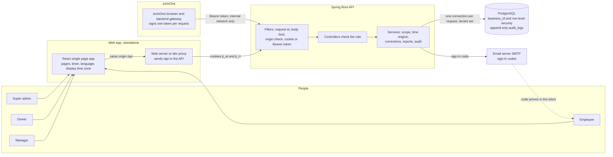

Caption: one API and one database serve every business in both modes; the only difference between standalone and embedded is how the caller is proven.

There is no scheduled job: nothing happens without a request. "Not ended" is computed when read (see section 5). Rate-limit and audit-aggregation windows live in memory of the API instance.

---

## 2. Sign-in by emailed code, session refresh and rate limits (FR-AUTH-1 to FR-AUTH-14)

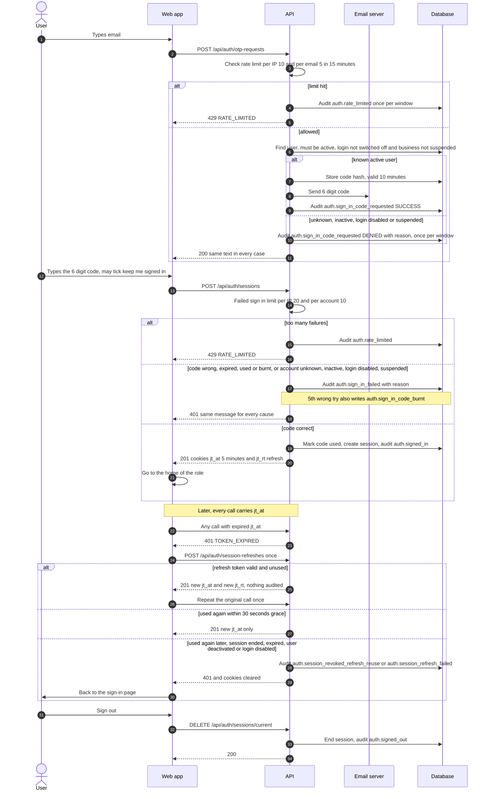

Caption: the answer to a code request never reveals whether the email exists, wrong tries and request counts are limited, and the short access cookie is renewed silently by a rotating refresh token.

The client address used by the limits is the connection's, or the one in `X-Forwarded-For` only when the request comes from a trusted proxy (FR-AUTH-14).

---

## 3. Start work, break, resume and end day (FR-TIME-1 to FR-TIME-10)

### 3.1 The states

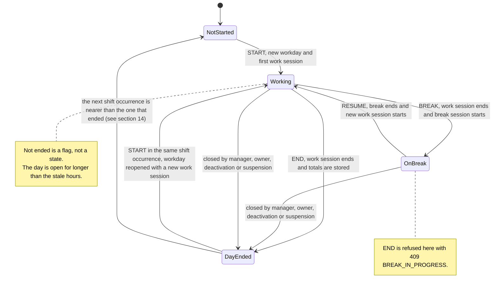

Caption: an employee is always in exactly one of four states, and only these moves are allowed; repeating the move you already made changes nothing.

### 3.2 What happens on one button press

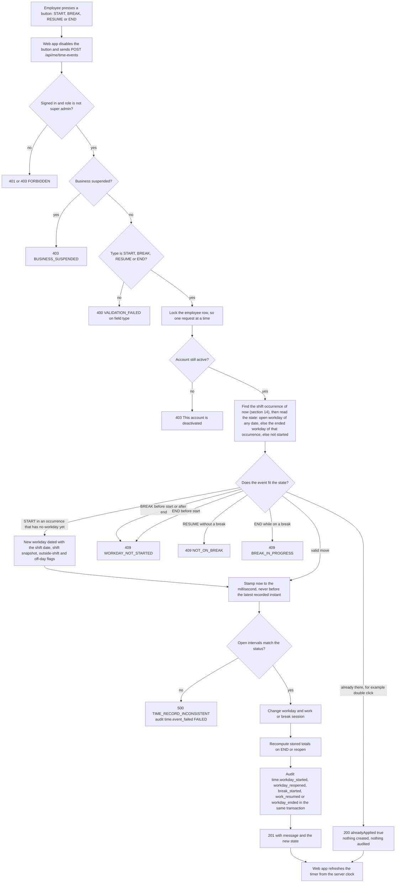

Caption: every press is checked against the stored state under a lock, a repeat is harmless, an impossible move gets a clear 409, and only a real change is audited.

The answer after a press (and the team board row) also carries `lastBreak`, the break that started last (FR-TIME-11, FR-TEAM-12); the employee and the manager see its start time next to the break count.

---

## 4. Reopening after End Day in the same shift occurrence (FR-TIME business rule "Reopening")

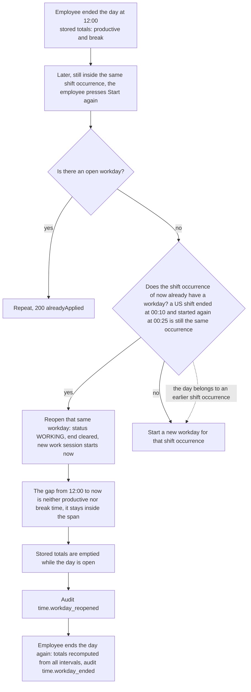

Caption: starting again in the same shift occurrence continues the same workday, and the time between the two stretches counts as neither work nor break; the next shift is a new workday.

---

## 5. Forgotten days: no auto-close, the Not ended flag and who can close a day

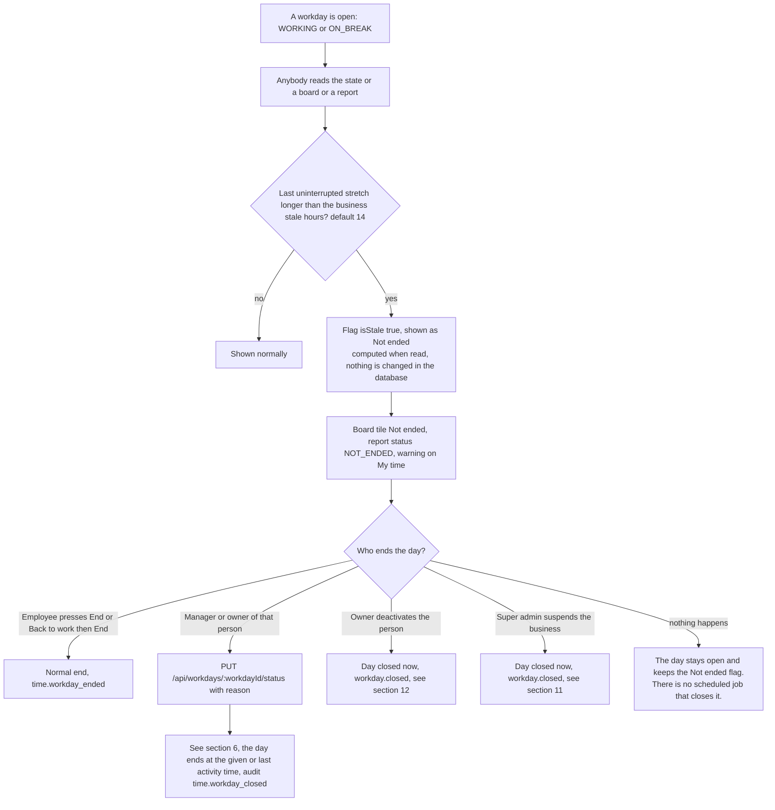

Caption: the system never closes a forgotten day by itself; it only flags it, and a person with the right scope, a deactivation or a suspension closes it.

---

## 6. Correction of time by a manager or the owner (FR-COR-1 to FR-COR-14)

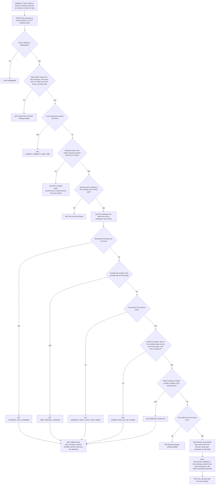

Caption: a correction passes role, body, own-record, scope and interval checks in a fixed order, then five business rules; any 422 is rolled back and recorded as a refusal, and a success is recorded with the reason in the same transaction.

For ending a forgotten day (`PUT .../status`) the "interval" steps are replaced by: end must not be before the last recorded activity, must be in the window, and an already ended day answers 200 "This workday had already ended." without an audit entry.

---

## 7. Team scope resolution: who a manager or owner may see (section 2.3 of the FRD)

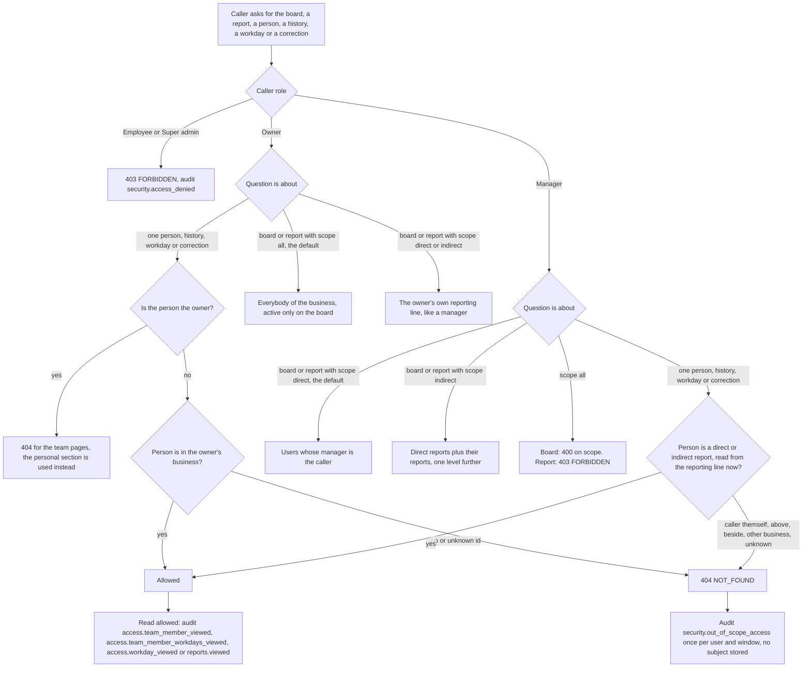

Caption: the reporting line decides, and anything outside it looks exactly like a record that does not exist.

---

## 8. Reports and CSV export (FR-REP-1 to FR-REP-13)

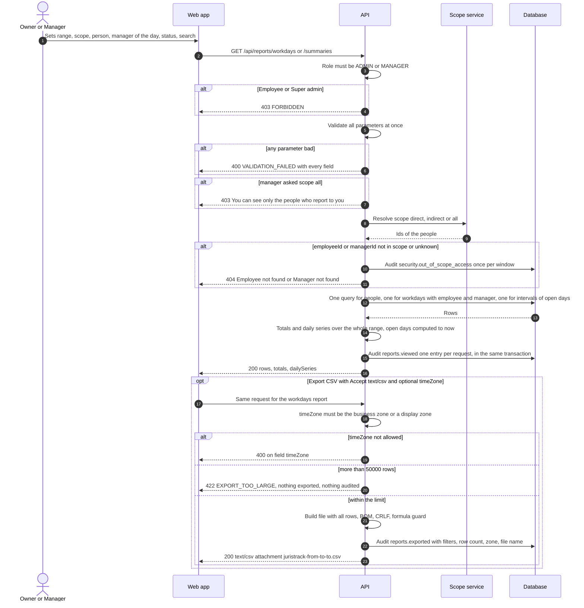

Caption: a report is checked and scoped before any data is read, covers the whole date range regardless of paging, and every read and every download writes one audit entry.

A report filtered on the owner's own id reads one's own data and is not audited.

---

## 9. Audit: how an entry is written and how it is read

### 9.1 Writing

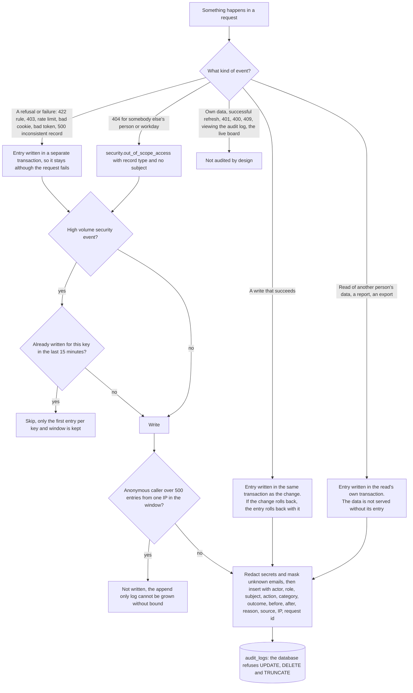

Caption: every movement is recorded in the right transaction, noisy security events are written once per 15 minutes, and nothing can change an entry afterwards.

### 9.2 Reading and exporting

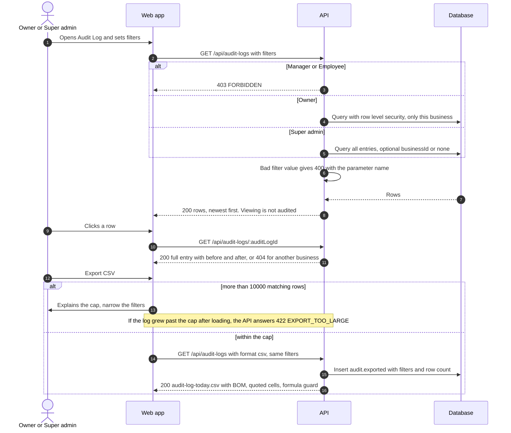

Caption: the owner reads only their own business, the super admin reads everything, viewing leaves no trace, and only an export is itself recorded.

---

## 10. Business creation and owner invitation by the super admin (FR-BIZ-1 to FR-BIZ-4)

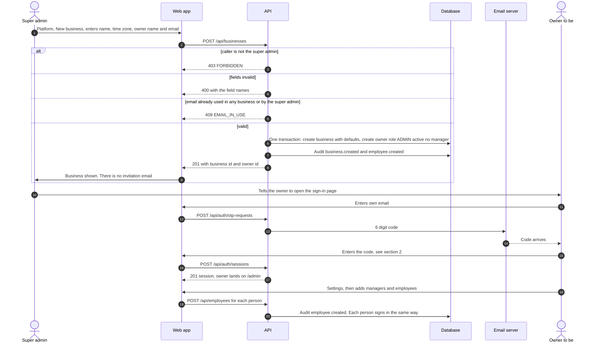

Caption: the super admin creates a business and its owner in one step; the owner then signs in with an emailed code like everyone else and adds their own people.

---

## 11. Business suspension and reactivation (FR-BIZ-6, FR-BIZ-7)

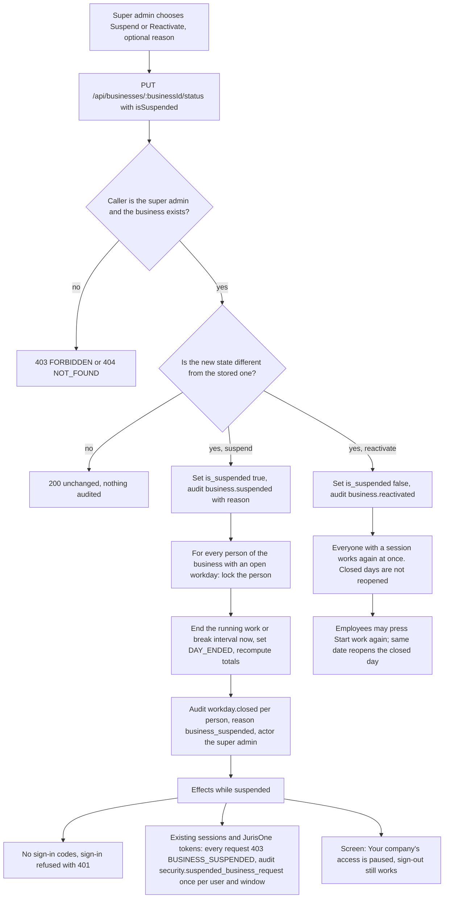

Caption: suspending a business stops the clocks of everyone working at that moment, so the suspension never counts as work, and reactivating changes nothing in the past.

---

## 12. Employee deactivation (FR-EMP-7 to FR-EMP-9)

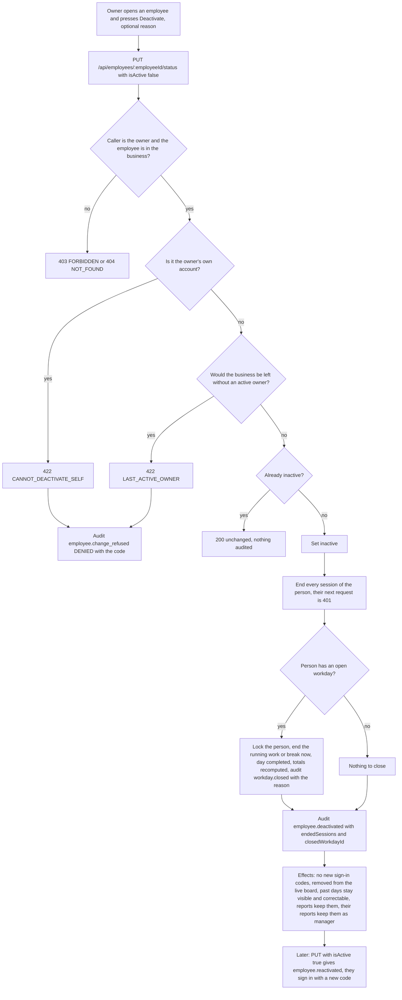

Caption: deactivating a person signs them out everywhere and stops their clock at that moment, while their history stays in place.

---

## 13. Embedded in JurisOne (summary only)

The full sequence is in [FLOW-JurisTrack-JurisOne-Connection.md](FLOW-JurisTrack-JurisOne-Connection.md). The short form:

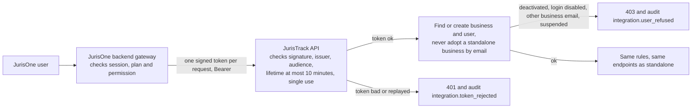

Caption: embedded use changes only how the caller is proven; once the token is accepted every rule in this document applies unchanged.

A standalone business is attached to JurisOne only by the super admin (`PUT /api/businesses/:businessId/jurisone-link`, audit `integration.business_linked`; `DELETE` removes it, audit `integration.business_unlinked`).

---

## 14. Shifts and the roster (FR-SHIFT-1 to FR-SHIFT-14)

Time is calculated per shift, not per calendar day: a US shift 19:30-04:30 is one nine-hour workday whichever calendar dates it touches. Reference: Time Doctor counts "Worked today" per calendar day; JurisTrack deliberately attributes per shift.

### 14.1 Which workday does an instant belong to

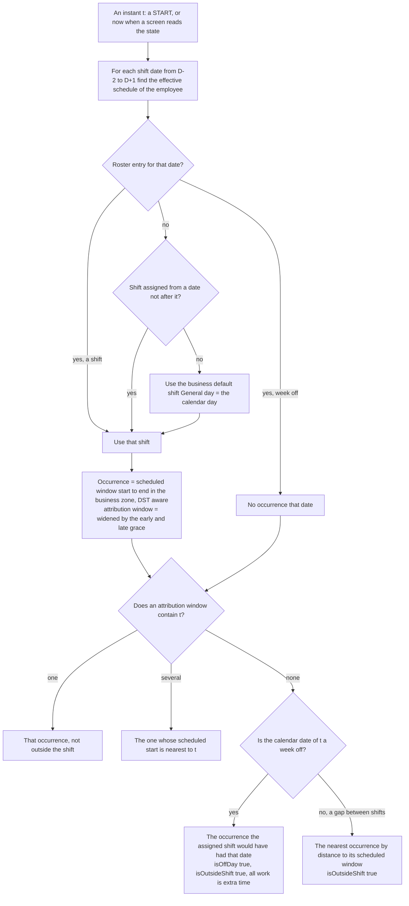

Caption: the shift decides the date of the workday; a start inside the grace belongs to the shift, a start outside any shift is still allowed and counted but flagged.

### 14.2 The START decision and what a screen shows

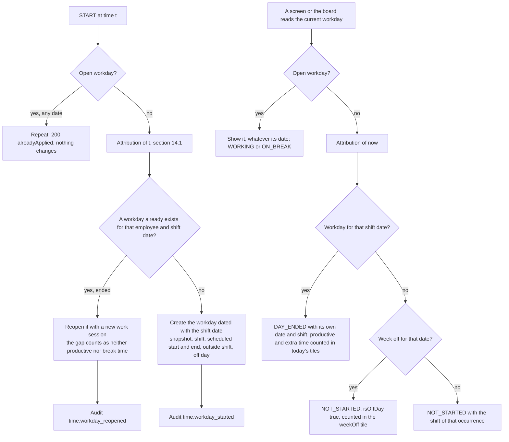

Caption: the same occurrence rule decides whether a START reopens the day or begins a new one and which workday a screen shows, so a shift that ended after midnight stays visible as DAY_ENDED until the next occurrence is nearer.

### 14.3 Example: a US shift across midnight

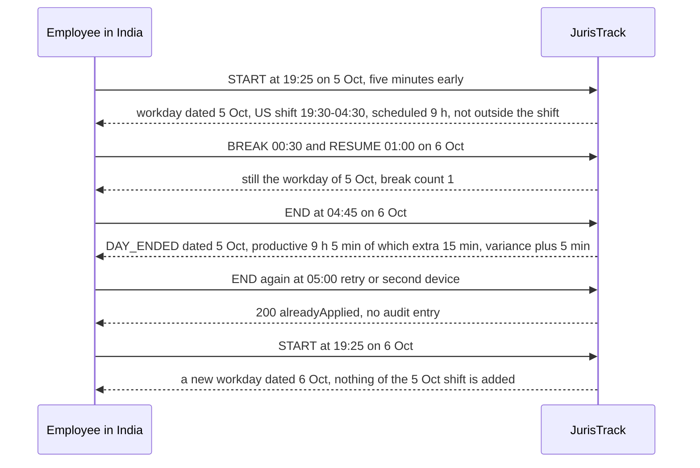

Caption: the 5 October shift and the 6 October shift are two workdays; work after midnight, a break after midnight and a repeated END never change a figure.

### 14.4 Managing shifts and the roster

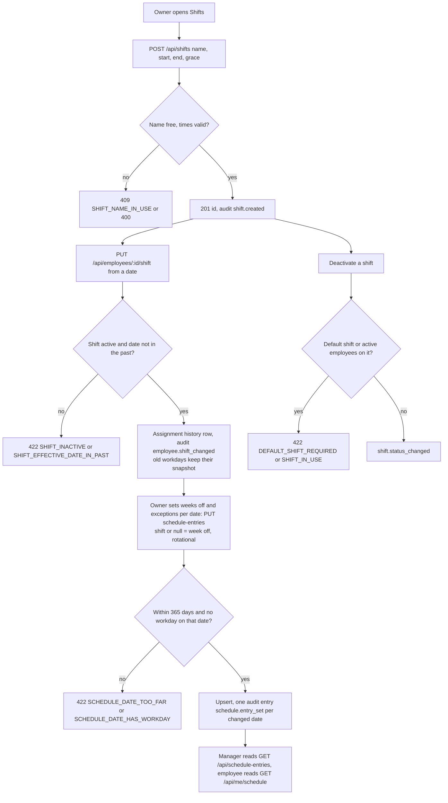

Caption: only the owner writes shifts, assignments and the roster; every change is audited and never rewrites a workday that already exists.
## 15. Employee login access (FR-EMP-10 to FR-EMP-14, FR-AUTH-15, FR-INT-8)

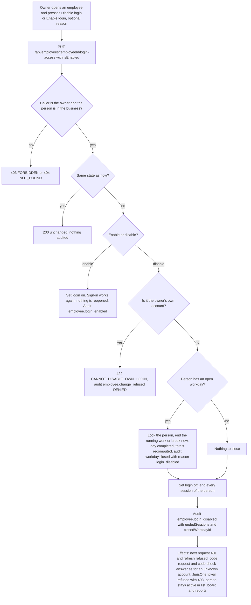

Caption: switching a login off signs the person out everywhere and stops their clock, but unlike Deactivate they stay in the business, the list and the reports.

The person's own attempts afterwards:

```mermaid
sequenceDiagram
    autonumber
    actor E as Employee with login off
    participant A as API
    participant D as Database
    E->>A: POST /api/auth/otp-requests with their email
    A->>D: Audit auth.sign_in_code_requested DENIED reason login_disabled, once per window
    A-->>E: 200 the usual text, no code is sent
    E->>A: POST /api/auth/sessions with any code
    A->>D: Audit auth.sign_in_failed reason login_disabled
    A-->>E: 401 That code is wrong or has expired, same as an unknown account
    E->>A: Request with an old cookie or a JurisOne token
    A-->>E: 401 for the cookie (session ended), 403 for the token with audit integration.user_refused login_disabled
```

Caption: the person learns nothing from the answers; only the audit log tells the owner why the sign-in was refused.

---

## Notes

- Mermaid check: see the report that came with this document version; the blocks were written to be plain flowchart, sequence and state diagrams with quoted labels and no parentheses in labels.
- Paths with ids are written `:workdayId` here instead of curly braces to keep the diagrams valid; the real paths are in `API.md`.
